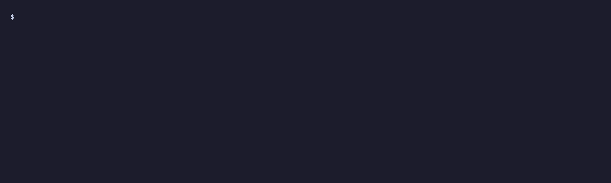

<div align="center">


# Qenome

**Did the rows read or written spike? Check the index before you merge it.**

[](https://www.npmjs.com/package/qenome)
[](LICENSE)
[](https://github.com/alern-c/Qenome/actions/workflows/quality.yml)

English | [日本語](README.ja.md)

 101 rows, and recommends suggested:1">

</div>

<p align="center"><sub>The recording comes from <a href="docs/usage.md#try-the-sample-project"><code>examples/d1-toml</code></a>; the sample runs on your machine with two commands.</sub></p>

From a wrangler project with a local D1 database, one command asks SQLite for a candidate index and compares it on a sandbox copy:

```sh
npx qenome --d1 DEMO_DB select.sql --suggest
```

The sample project (`examples/d1-toml`) returns this result:

```text
Recommendation: suggested:1

Results
  query       candidate    result        verdict       rows read
  select.sql  suggested:1  match         improved      200000 -> 101
```

Rows read fell from 200,000 to 101, and the exit status is 0. The original database is not changed. The recording above is the same run. See [Try the sample project](docs/usage.md#try-the-sample-project) for the two setup commands.

Give it one read-only `SELECT` and one `CREATE INDEX`. With `--write`, give it one `INSERT`, `UPDATE`, `DELETE`, or `REPLACE` instead. It copies a local SQLite file, or a local Cloudflare D1 database (`--d1 <BINDING>`, `--config`), into sandbox snapshots and compares them. The original database is never modified.

## Install

On Linux and macOS, for x64 and arm64, install the command once:

```sh
npm install -g qenome
qenome --version
```

To try Qenome without installing it, run `npx qenome`. Windows is not an npm target: use a prebuilt binary from [Releases](https://github.com/alern-c/Qenome/releases), after checking it against `SHA256SUMS`. The install steps for every platform and a build from source are in [Installation](docs/installation.md).

## Features

- **Your database stays untouched.** Qenome opens the original read-only and compares sandbox copies, so a candidate index that does not help can be dropped before the merge.
- **The verdict comes from the rows read, not the time.** Rows read and rows written use the same counting as local D1 (workerd patch); `--runs 0` keeps the verdict and skips the timing.
- **The result rows are checked too.** Both copies must return the same rows as a multiset; a mismatch or an incomparable result is reported instead of a pass.
- **See whether an improvement holds as the table grows.** `--seed-data` with `--scale` measures the same comparison at 2 or 3 sizes and shows the rows read side by side; see [Measuring at several sizes](docs/usage.md#measuring-at-several-sizes---scale).
- **See what an index costs a write.** `--write` runs one `INSERT`, `UPDATE`, `DELETE`, or `REPLACE` in a rolled-back transaction on each copy and reports the rows written on both sides, including secondary-index inserts, triggers, and foreign-key cascades. See [Comparing a write](docs/usage.md#comparing-a-write).
- **A local D1 binding is enough.** `--d1 <BINDING>` finds the local database from a wrangler config, and `--config` names the config.
- **Compare many queries in one run.** `--batch <FILE>` pairs every SELECT in a JSON manifest with every candidate `CREATE INDEX` and reports each pair; see [Batch comparisons](docs/batch.md#batch-comparisons).
- **Find the indexes a manifest does not use.** `--batch manifest.json --audit-indexes` lists the indexes that no query plan named, the indexes whose leading columns another index or the primary key covers, and the UNIQUE and PRIMARY KEY indexes that stay for their constraint; see [Index audit (--audit-indexes)](docs/batch.md#index-audit---audit-indexes).
- **Find the query that reads the most, before you have an index.** `--batch manifest.json --rank` measures every query on the baseline and ranks it by rows read, flags a likely full scan, and points at `--suggest` for the top query. Rows read times runs is a relative indicator, not a bill. See [Ranking queries on the baseline (--rank)](docs/batch.md#ranking-queries-on-the-baseline---rank).
- **Build a manifest from the queries your app runs.** `qenome/d1` records the SELECTs and bind values that run against a local D1, and `--record` turns the log into a manifest you can compare; see [Recording the queries your app runs (--record)](docs/batch.md#recording-the-queries-your-app-runs---record).
- **Find a candidate from the query.** `--suggest` lets SQLite's expert propose candidate indexes and compares them, so a SELECT file is enough; see [Suggesting candidate indexes](docs/batch.md#suggesting-candidate-indexes).
- **JSON for AI agents and CI.** `--format json` gives the report with `schema_version` 2, and the exit status separates a match, a mismatch, and an incomparable result.
- **The evidence stays next to the verdict.** The query plan, the median times, the size increase of the whole database, and advisory warnings are in the report.

> The row numbers have not yet been checked against production D1. Qenome measures the local database only. See [Accuracy and production D1](docs/accuracy.md) for how the rows are counted and what can differ from production D1.

## Contents

- [Install](#install): npm on Linux and macOS, or `npx qenome` without installing
- [Features](#features)
- [Installation details](docs/installation.md): npm, prebuilt binaries, checksums, and a build from source
- [Check a local D1](docs/local-d1.md): the first comparison, from a wrangler project
- [My D1 bill spiked](docs/bill-spiked.md): find the missing index from a rows-read jump
- [Use with AI agents](docs/agents.md): the skill, the JSON report, and the install commands
- [Why not ...](docs/why-not.md): EXPLAIN QUERY PLAN, wrangler, production metrics, and applying the index
- [Usage](docs/usage.md): every option, writes, seed data, and D1 local databases
- [Batch comparisons](docs/batch.md): many queries and candidates, index audit, recording, and suggestions
- [Output formats](docs/output.md): human, kv, json, exit status, and timing evidence
- [Accuracy and production D1](docs/accuracy.md): how rows are counted, what the verdicts mean, and what can differ from production D1
- [Rules](docs/rules.md): what Qenome guarantees and rejects
- [Contributing](#contributing)
- [License](#license)

From this README, a D1 developer or their AI agent can get that verdict on a local D1 in a few minutes. See [Check a local D1](docs/local-d1.md) and [Use with AI agents](docs/agents.md).

## Contributing

The build-from-source Quick start, the development checks, and how to update the golden test output are in [CONTRIBUTING.md](CONTRIBUTING.md).

## License

Qenome is licensed under the Apache License 2.0. See [LICENSE](LICENSE) for the full text.

The bundled SQLite amalgamation stays in the public domain, and the row-count patch in `vendor/sqlite3/patches` keeps its own notices. See [NOTICE](NOTICE) for both.
